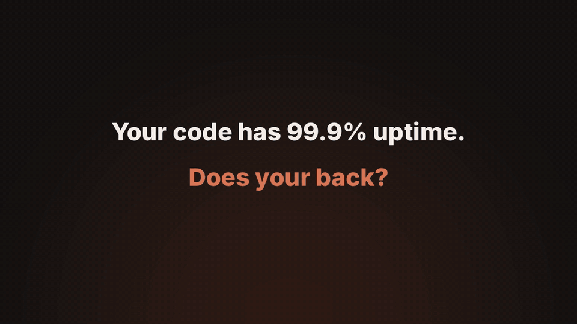
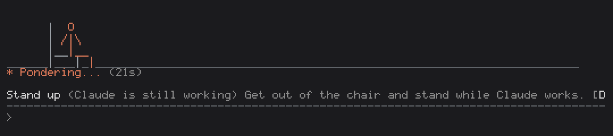
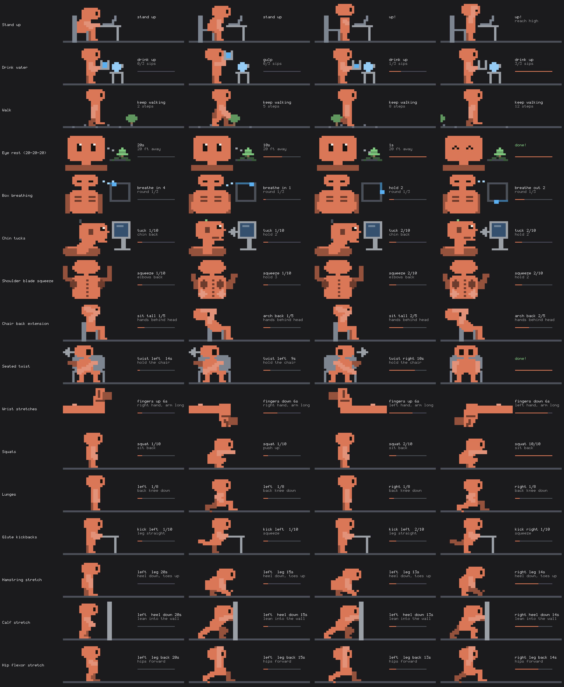

# 30yr-uptime

A Claude Code mod that turns the time you spend waiting on Claude into short movement breaks. Every 45 minutes, the next time a turn runs longer than 15 seconds, a break shows above the prompt: something for your neck, shoulders, back, hips, legs, wrists, eyes or lungs, acted out by a little pixel character. Press **Done**, **In 5 min** or **Skip**. It all happens in the terminal and runs locally: no network, no model calls, no tokens.



> **Chin tucks** 10 reps: slide your head straight back, hold for 2 seconds. Resets your neck over your spine. Skip it and your head keeps drifting toward the monitor.

The character is an unofficial fan take on Clawd, Claude Code's character; this mod is not made or endorsed by Anthropic.

## The moves



| Move | Setting key | What it is for |
| --- | --- | --- |
| Stand up | `stand` | Getting out of the chair |
| Drink water | `water` | Hydration |
| Walk | `walk` | Circulation |
| Eye rest (20-20-20) | `eyes` | Eye strain: 20 feet away for 20 seconds |
| Box breathing | `breathe` | In 4, hold 4, out 4, hold 4, three rounds |
| Chin tucks | `neck` | Forward head posture |
| Shoulder blade squeeze | `shoulders` | Rounded shoulders |
| Chair back extension | `thoracic` | Hunching (upper back) |
| Seated twist | `twist` | Spine rotation, 15 seconds each side |
| Wrist stretches | `wrists` | Forearms and wrists, both hands, fingers up and down |
| Squats | `squat` | Glutes and thighs |
| Lunges | `lunge` | Legs, one at a time, and the front of the hips |
| Glute kickbacks | `glutes` | Weak glutes, 10 each side |
| Hamstring stretch | `hamstring` | Tight backs of the thighs, 20 seconds each leg |
| Calf stretch | `calf` | Tight calves and ankles, 20 seconds each leg |
| Hip flexor stretch | `hipflexor` | Hips that sitting keeps folded, 20 seconds each side |

All of them are done standing or sitting next to the desk, with no equipment.

Each move is animated and framed on the part of the body it works (chin tucks are a close-up of the head and neck), with reps counted, holds counted down and a progress bar. Breaks are picked at random from the moves you have on, one at a time, never the same move twice in a row. Terminals narrower than 54 columns get words and buttons only, and [`NO_COLOR`](https://no-color.org) is respected.



## Install

```
/plugin marketplace add https://github.com/mamrezme/30yr-uptime.git
/plugin install 30yr-uptime@30yr-uptime
```

Then `/reload-plugins` (or restart Claude Code). The HTTPS link works with or without SSH keys for GitHub; the short form `mamrezme/30yr-uptime` may try SSH first. Or run it from a clone without installing:

```sh
git clone https://github.com/mamrezme/30yr-uptime.git
claude --plugin-dir ./30yr-uptime
```

To update: `/plugin marketplace update 30yr-uptime`, then `/plugin update 30yr-uptime@30yr-uptime`. To remove it: `/plugin uninstall 30yr-uptime@30yr-uptime`.

Needs Claude Code 2.1.287 or newer (mods are on by default from there); tested on 2.1.319. The animation needs a terminal at least 54 columns wide; narrower, the break shows as words and buttons only.

## The `/break` command

| Command | What it does |
| --- | --- |
| `/break` | Starts a break now, with its animation: a random move among the ones you have on. If a break is already on show, it stays and the command says so. |
| `/break off` | Turns the reminders off, in this session and the next ones, until `/break on`. A snoozed break is dropped. `/break` still starts a break when you ask for one. |
| `/break on` | Turns the reminders back on. The wait starts over from that moment, so no reminder shows straight away. |
| `/break config` | Lists the settings as they apply now. |
| `/break moves` | Lists every move, its key, and whether it is on. |
| `/break set <key> <value>` | Changes a setting, e.g. `/break set waitSeconds 30` or `/break set squat off`. |
| `/break reset [key]` | Puts one setting back to its default, or all of them with no key. |

`/break` runs at once, even while Claude is working. The mod's store holds only whether reminders are off and the settings you changed; Done, Skip and In 5 min keep no record.

## Settings

Installing asks nothing: every setting has a default and the mod works as it is. To change one, use `/break set` (see [the `/break` command](#the-break-command)); it applies at once and is kept for later sessions.

| Setting | Default | What it does |
| --- | --- | --- |
| `waitSeconds` | 15 | How long a turn must run before a break is suggested. 1 to 3600. |
| `intervalMinutes` | 45 | The shortest time between two breaks, counted from the session start for the first one: a break waits until this long has passed and a turn runs past `waitSeconds`. Never while Claude is idle. 1 to 1440; 0 gives every long turn a break. |
| one key per move (see [the moves](#the-moves)) | on | Whether that move can be suggested. |

Turn off the moves you can't or don't want to do (`/break set squat off`); with every move off, no breaks are shown. `/break set` refuses a value that is not a number (or a negative one) and a move value other than on or off (`on`/`off`, `true`/`false`, `yes`/`no`, `1`/`0`), and clamps a number to its range. Changing a setting keeps the break on show and a snoozed one.

The settings are not in `/config`: Claude Code counts every `/config` option of a plugin as "not yet set" after install, even one with a default, and asks you to configure it.

## What the hooks do

`hooks/register.tsx` hooks six events. It reads them and draws; it never changes what Claude sees or sends:

- `session.start`: reads whether you turned reminders off and the settings you changed, checks `NO_COLOR`, registers `/break`, and in an interactive session starts a 5-second timer that decides when a break is due.
- `command.run` for `/break`: starts a break now, turns the reminders off or on, or shows and changes the settings, and remembers those choices.
- `turn.start`: notes when Claude's main turn began, so a long turn can be spotted (a subagent's turn doesn't count).
- `turn.complete`: notes that the main turn ended and takes the scene off the spinner.
- `ui.render` on `Spinner`: while a break is on show and Claude works, draws its scene above the spinner line and leaves the spinner as it is. Below 54 columns, or outside the terminal, it hands the spinner back unchanged.
- `ui.render` on `AbovePrompt`: shows the break's words and the Done, In 5 min and Skip buttons, with the scene above them while Claude is idle.

While a scene is on screen, a timer repaints it about 12 times a second; it stops as soon as the break is answered.

## Privacy: what data it sends

None. The mod makes no network requests and no model calls, so it uses none of your tokens. It doesn't read your prompts, Claude's replies, your files or your code: it only sees when a turn starts and ends, the terminal size, and `NO_COLOR`. Every line of text is written into the mod; none is generated. It stores two things in Claude Code's own plugin store: whether you ran `/break off` (`paused`) and the settings you changed with `/break set` (`settings`). It keeps no record of the breaks you took or skipped. There is no server, so there is no privacy policy to link.
